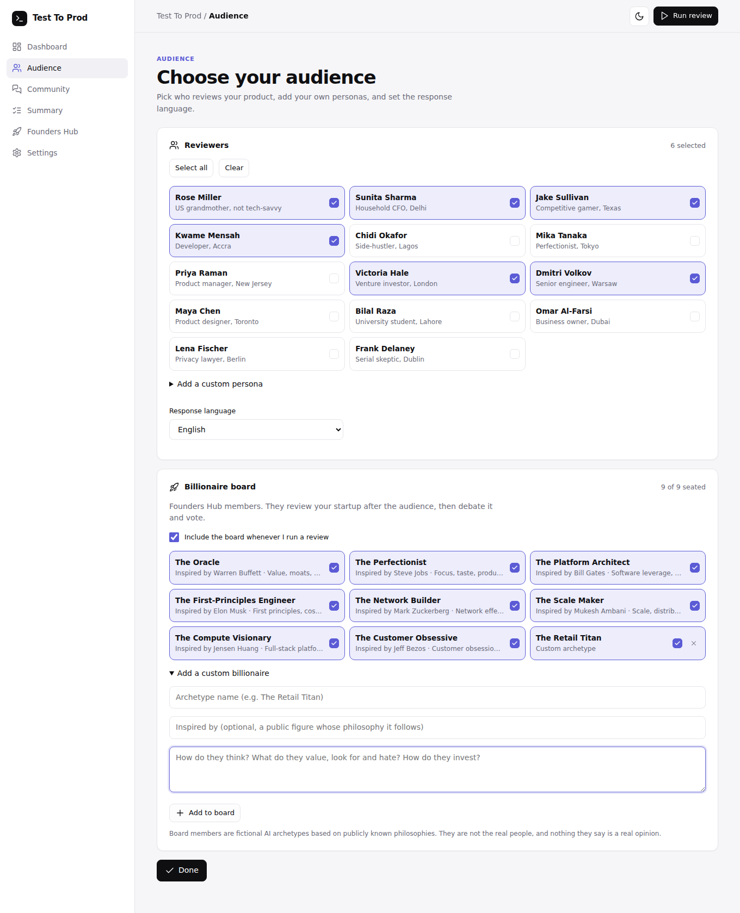
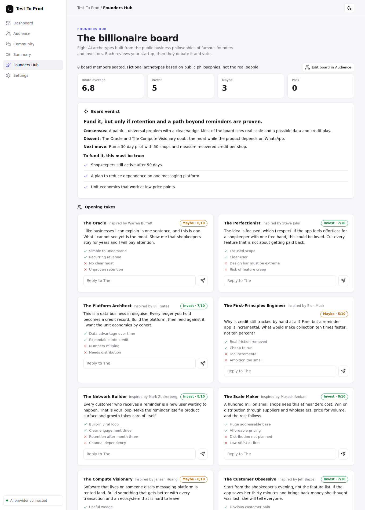
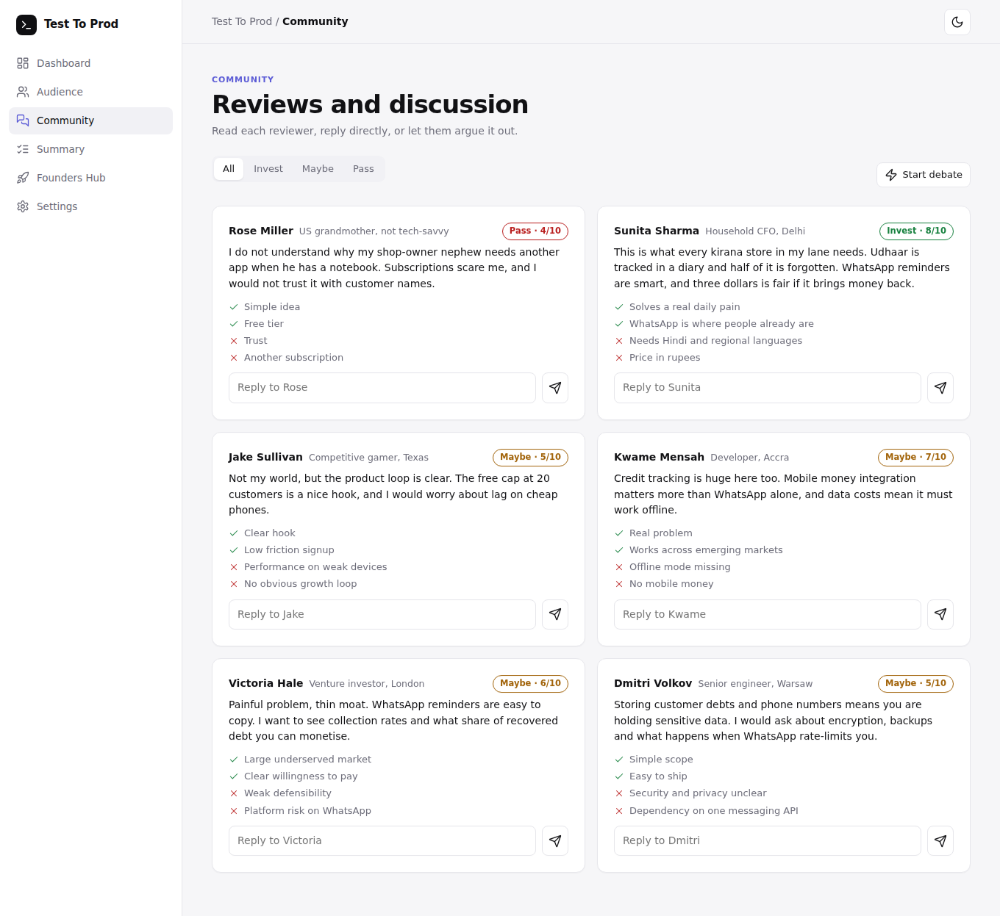
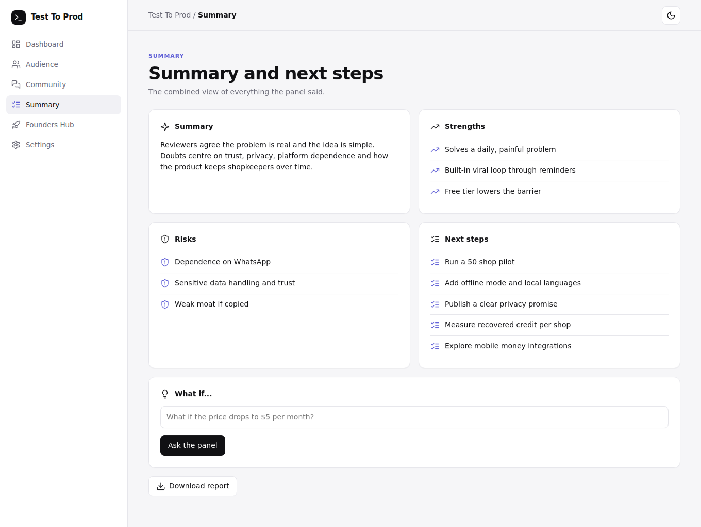
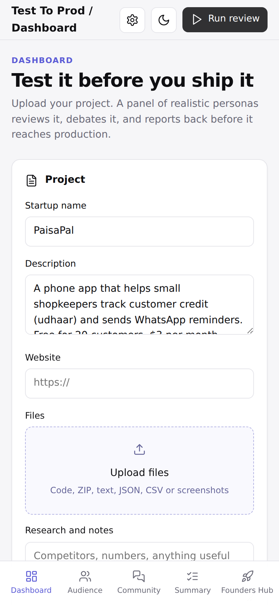
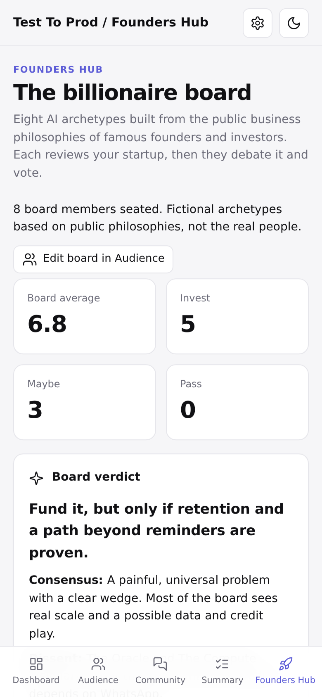
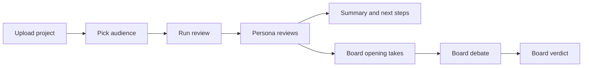

<div align="center">

# Test To Prod

**Test your startup on a panel of AI personas and a billionaire board before it reaches production.**

Upload your project. Realistic reviewers pick it apart, a board of founder-investor archetypes debates it, and you get a clear summary with next steps. One HTML file. No build. No backend.

[](LICENSE)


[Quick start](#quick-start) · [Features](#features) · [How it works](#how-it-works) · [Configuration](#configuration) · [FAQ](#faq) · [Contributing](#contributing)


</div>

> Screenshots in this repository use a simulated demo run for a fictional startup. The reviews are AI generated examples, not real feedback.

## Table of contents

- [Why Test To Prod](#why-test-to-prod)
- [Features](#features)
- [Screenshots](#screenshots)
- [Quick start](#quick-start)
- [How it works](#how-it-works)
- [Usage guide](#usage-guide)
- [The billionaire board](#the-billionaire-board)
- [Configuration](#configuration)
- [Privacy and security](#privacy-and-security)
- [Customization](#customization)
- [Project structure](#project-structure)
- [Troubleshooting](#troubleshooting)
- [FAQ](#faq)
- [Roadmap](#roadmap)
- [Contributing](#contributing)
- [License](#license)
- [Disclaimer](#disclaimer)

## Why Test To Prod

Most founders hear honest opinions too late. Friends are polite, and real users arrive after you have already built the thing. Test To Prod gives you fast, blunt, diverse feedback from people who do not look like you: a retired teacher who fears subscriptions, a developer on expensive mobile data, a venture investor hunting for a moat.

It is a thinking tool, not an oracle. Use it to find the questions you have not asked yet.

## Features

**Review and debate**
- Upload code, ZIP archives, text, JSON, CSV, screenshots, links and research notes.
- 14 built-in reviewer personas with real budgets, habits and objections, plus unlimited custom personas.
- Structured reviews: score out of 10, verdict (Invest, Maybe, Pass), pros and cons.
- Community feed with filters, direct replies to any reviewer and a one-click debate between reviewers.
- Summary page with strengths, risks, five concrete next steps and a "what if" simulator.

**Billionaire board (Founders Hub)**
- Eight fictional founder-investor archetypes, plus your own custom ones.
- Each gives an opening take, then they debate each other, then the board votes with a verdict, dissent and funding conditions.
- Select who sits on the board, or switch it off.

**Product**
- Fully responsive: sidebar layout on desktop, bottom tab bar on phones.
- Guided onboarding, a getting-started checklist and helpful empty states.
- Light, dark and system themes.
- Results and settings persist in your browser.
- Model picker with live OpenRouter model list, search and free-model badges, or type any model ID.
- Automatic model fallbacks, rate-limit retries and request timeouts.
- Responses in English, Roman Urdu, Urdu, Hindi or Hinglish.
- Markdown report export.
- Reads ZIP files in the browser without any library, skipping `node_modules` and `vendor`.

## Screenshots

| Audience | Founders Hub |
|---|---|
|  |  |

| Community | Summary |
|---|---|
|  |  |

| Mobile dashboard | Mobile Founders Hub |
|---|---|
|  |  |

## Quick start

You need a free [OpenRouter](https://openrouter.ai/keys) API key.

**Option 1: open the file**

```bash
git clone https://github.com/Really-Muhammad/Test-to-Prod.git
cd Test-to-Prod
open test-to-prod.html   # macOS. On Linux use xdg-open, on Windows just double-click.
```

**Option 2: serve it locally**

```bash
python3 -m http.server 8080
# then visit http://localhost:8080/test-to-prod.html
```

**Option 3: GitHub Pages**

1. Rename `test-to-prod.html` to `index.html`.
2. In your repository go to Settings, then Pages, and publish from the `main` branch.
3. Open the Pages URL.

On first launch the onboarding walks you through adding your key, describing your project and picking a panel.

## How it works



Everything runs in your browser. The page builds a prompt from your project and files, sends one request per persona to OpenRouter and renders the JSON that comes back. Requests run three at a time, with retries on rate limits.

## Usage guide

1. **Dashboard.** Name your startup, describe it, add a website, upload files and paste notes.
2. **Audience.** Choose reviewers and board members. Add custom ones. Pick the response language.
3. **Run review.** Reviews stream in with a progress bar. The board follows automatically if enabled.
4. **Community.** Read reviews, filter by verdict, reply to anyone, or start a debate.
5. **Summary.** Strengths, risks, next steps, plus "what if" questions such as "What if the price drops to $5 per month?"
6. **Founders Hub.** Board scores, verdict, opening takes and the full debate.
7. **Download report.** A Markdown file with the summary, board verdict and every review.

Supported uploads: `.zip`, and text-like files (`.txt .md .html .css .js .jsx .ts .tsx .json .csv .py .php .java .xml .yml .yaml .sql .vue`). Other files, such as screenshots, are attached by name only; reviewers do not see image contents.

## The billionaire board

The board members are **fictional AI archetypes** built from publicly known business and investing philosophies. They are not the real people, never claim to be, and nothing they say is a real opinion.

| Archetype | Inspired by | Lens |
|---|---|---|
| The Oracle | Warren Buffett | Value, moats, margin of safety |
| The Perfectionist | Steve Jobs | Focus, taste, product experience |
| The Platform Architect | Bill Gates | Software leverage, platforms, data |
| The First-Principles Engineer | Elon Musk | First principles, cost curves, ambition |
| The Network Builder | Mark Zuckerberg | Network effects, growth loops, speed |
| The Scale Maker | Mukesh Ambani | Scale, distribution, affordability |
| The Compute Visionary | Jensen Huang | Full-stack platforms, ecosystems |
| The Customer Obsessive | Jeff Bezos | Customer obsession, flywheels, long term |

Add your own in **Audience, Add a custom billionaire** by describing how they think and invest.

## Configuration

Open **Settings** in the app.

| Setting | Description |
|---|---|
| OpenRouter API key | Stored only in your browser's `localStorage`. |
| Model | Pick from the live list or type any OpenRouter model ID. Empty uses the default free model. |
| Response language | English, Roman Urdu, Urdu, Hindi or Hinglish. |
| Theme | System, light or dark. |

Defaults and fallbacks for free models:

```js
const DEF = "thinkingmachines/inkling:free";
const FB  = [DEF, "google/gemma-4-31b-it:free", "openrouter/free"];
```

Free model names change over time. If one disappears, pick another in Settings or edit `DEF` and `FB`.

## Privacy and security

- No backend, no analytics, no tracking, no cookies.
- Your API key and project data stay in `localStorage` in your browser.
- The only network calls go to `openrouter.ai`: chat completions, and the public model list.
- Your project text and the contents of uploaded text files are sent to OpenRouter and the model provider to generate reviews. Do not upload secrets or private data you would not share with an AI provider.
- All model output is inserted with `textContent`, never as HTML.
- Use **Settings, Reset all data** to wipe everything from the browser.

## Customization

Everything lives in `test-to-prod.html`.

- **Reviewer personas:** edit the `R` array (`[name, label, bio]`).
- **Board archetypes:** edit the `T` array (`[name, inspired by, lens, style]`).
- **Languages:** add `<option>` entries to the `#lg` select and the onboarding step.
- **Theme:** colors are CSS variables on `:root` at the top of the stylesheet.
- **Prompts:** search for `Reply ONLY with JSON` to find and tweak each prompt.

## Project structure

```text
.
├── test-to-prod.html          The whole app: HTML, CSS and JavaScript
├── README.md
├── LICENSE
├── THIRD_PARTY_NOTICES.md
└── docs/
    └── screenshots/           Images used in this README
```

## Troubleshooting

| Problem | Fix |
|---|---|
| "Invalid API key (401)" | Re-enter your key in Settings. |
| "No reviews came back" plus a message | Read the message. Common causes: rate limit, model unavailable, or no credits. Try another model. |
| Slow or stuck | Free models are rate limited. Reviews retry automatically. Try a different or paid model. |
| File picker does not open | Open the page in a regular browser such as Chrome instead of an in-app viewer. |
| ZIP not parsed | ZIP64 archives are not supported. Re-create the archive without ZIP64. |
| Screenshots not understood | Image contents are not sent. Describe the screens in your notes. |

## FAQ

**Is this a replacement for talking to real users?**
No. It is a fast way to find blind spots before you do.

**Is it free?**
The app is free and open source. AI usage depends on the model you choose; OpenRouter offers free models with limits.

**Are the reviews real opinions of the named people?**
No. See the [disclaimer](#disclaimer).

**Can I use it offline?**
The interface works offline, but reviews need an internet connection to reach OpenRouter.

## Roadmap

- [ ] Image understanding for screenshots with vision models
- [ ] Share a read-only results link
- [ ] Compare two runs side by side
- [ ] Import and export personas as JSON
- [ ] More languages
- [ ] Optional streaming responses

## Contributing

Pull requests are welcome.

1. Fork the repository and create a branch.
2. Keep the project dependency-free and single-file unless there is a strong reason.
3. Test on a desktop and a phone-sized viewport, in light and dark themes.
4. Open a pull request describing the change and include a screenshot for UI changes.

Please open an issue first for large changes.

## License

Released under the [MIT License](LICENSE). Third-party notices are in [THIRD_PARTY_NOTICES.md](THIRD_PARTY_NOTICES.md); icons are from [Lucide](https://lucide.dev) (ISC).

## Disclaimer

Test To Prod produces simulated, AI generated opinions for brainstorming. It is not investment, legal or business advice. Named public figures appear only as inspiration for fictional archetypes; this project is not affiliated with, endorsed by, or speaking for any of them.
